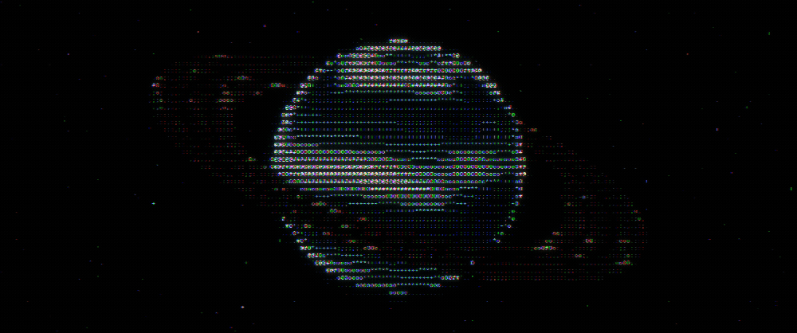

Hi, I'm Art 👋
Software Engineering student at DuocUC (Chile). I lead the 3D printing track at my university, where I design solutions and coordinate teams.

Currently learning: Python, JavaScript, APIs, databases, and full-stack development.

Languages: Spanish (native) | English (TOEIC 940 — CEFR B2)

Interests: Backend development, AI, automation, open source

Connect: arturo.moya.contact@gmail.com

